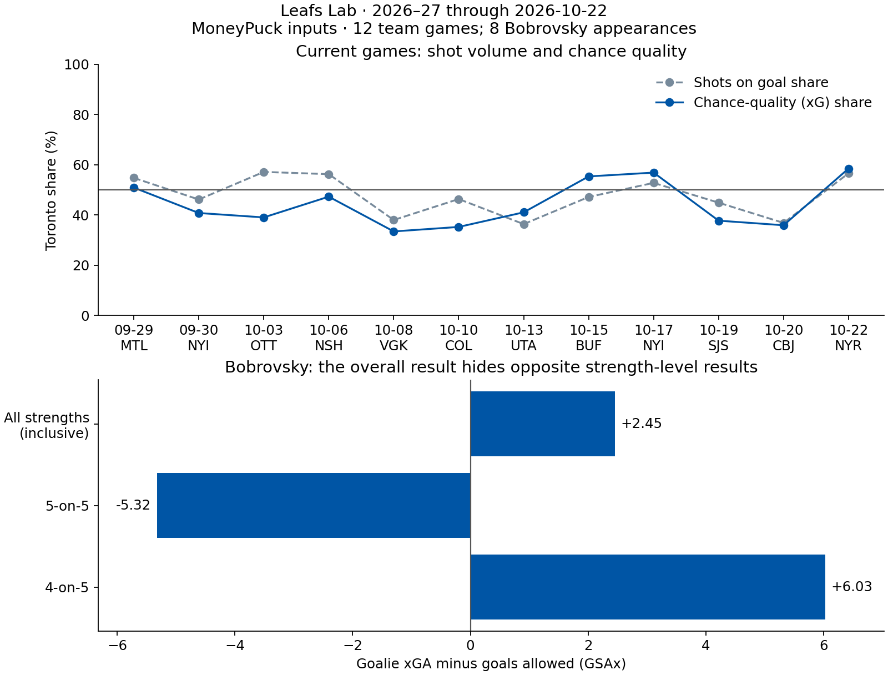

# Current-season Leafs Lab evidence

Refreshed October 24, 2026 (New Zealand time). MoneyPuck originals were downloaded October 23 at 21:25 UTC. Coverage is 12 Toronto games, September 29–October 22, 2026; 216 skater appearances and 12 goalie appearances. Dataset and Watch companion share original-file hashes and game identifiers. Automatic refresh remains disabled.

## Active questions

At 5-on-5 Toronto has 252 shots for and 272 against (48.1% share), but 21.390 xG for and 26.804 against (44.4%). Unblocked attempts are 378–415, averaging 0.0566 xG for and 0.0646 against. High-danger attempts are 5–18. Toronto was below 50% xG in eight of 12 games. Leave-one-game-out shares range from 43.0% to 45.4%; this is a sensitivity check, not a confidence interval. Attack quality versus volume remains an active question.

| Bobrovsky: eight appearances | xGA | GA | GSAx |
| --- | ---: | ---: | ---: |
| All strengths, inclusive | 27.451 | 25 | +2.451 |
| 5-on-5 | 18.676 | 24 | -5.324 |
| 4-on-5 | 6.028 | 0 | +6.028 |

All strengths overlaps the component rows; never add them together. The strength split persists descriptively, without proving goalie ability, defensive quality or future outcomes.

Marchenko’s replacement question is **“Is Marchenko creating dangerous opportunities consistently, beyond the goals?”** He has two 5-on-5 goals from 2.326 individual xG over 170.7 minutes in 12 appearances, third in Toronto individual xG. His shared on-ice xG is 7.546–5.910 (56.1%). The guide includes each game's own shots, individual xG, goals and shared on-ice xG. Shared numbers do not isolate his impact or adjust for teammates, opposition or deployment.

## Question archive

“Is Marchenko’s scoring line hiding chance creation?” originally covered six games through October 10, with zero 5-on-5 goals. Archived October 24 as superseded following the October 15 hat trick against Buffalo. [Official NHL evidence](https://www.nhl.com/mapleleafs/video/topic/game-highlights/buf-tor-marchenko-has-a-hat-trick-against-the-sabres-6406934594112). A scoring burst changes the drought framing without establishing persistent chance generation. The replacement was accepted by the owner.

## Latest game and validation

The [official NHL summary](https://www.nhl.com/gamecenter/nyr-vs-tor/2026/10/22/2026020155/summary) confirms Toronto’s October 22 win over the Rangers, 5–4. It is the latest game in all three provider files. The refreshed reports add Utah, Buffalo, Islanders, San Jose, Columbus and Rangers since the prior snapshot.

Source URLs, actual retrieval timestamps, byte counts, headers and SHA-256 hashes are preserved in `analysis/data/current-2026.json` and `analysis/current-proof-results.json`. Original full CSVs remain outside tracked source; portable input keeps only analysis columns.

Reproduce after downloading with the checked configuration:

```sh
python3 scripts/refresh_watch.py --raw-dir <download-directory> --bundle <candidate-json>
python3 analysis/current_game_proof.py --plot
```

Calculations validate unique keys, season identifiers, matching game/date/opponent coverage, all five strength situations, individual-to-team reconciliation and team strength totals. All-strength and primary-strength individual goals, xG and unblocked attempts reconcile within 0.02 xG rounding tolerance. Player `other` partitions have discrepancies in Nashville, Vegas and Buffalo; recorded notes retain them and those partitions are excluded from interpretation. Missing values fail rather than becoming zero.

The model belongs to MoneyPuck. Leafs Lab adds joined evidence, questions, game-by-game follow-up and explicit limits. No tactical tracking, coaching causation, prior-season baseline or forecast is claimed.


